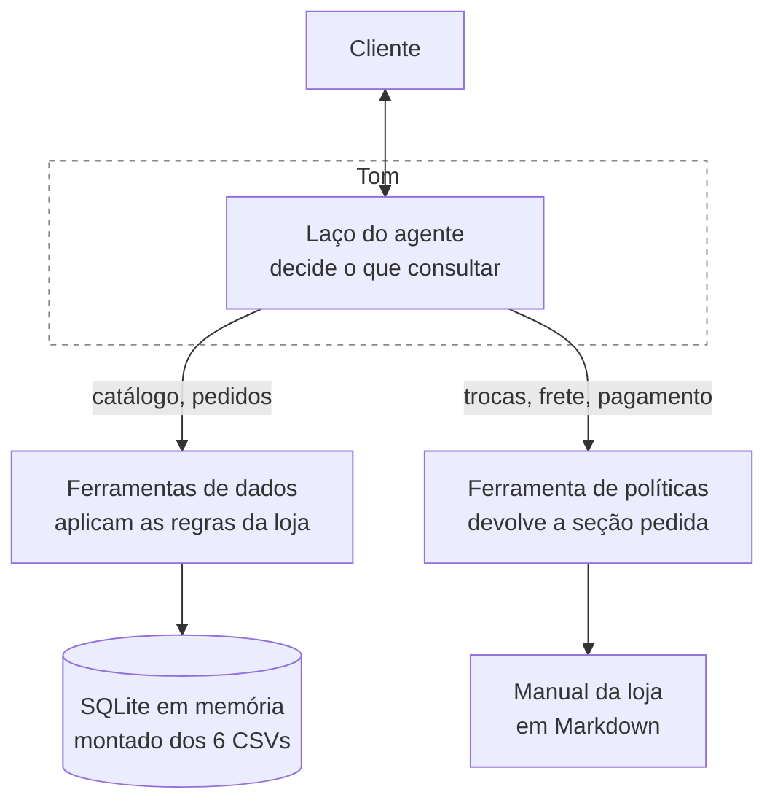

# Tom · Agente de atendimento da Empório da Música

Agente de atendimento por mensagem de texto para uma loja de instrumentos musicais.
Responde dúvidas sobre catálogo, preços, disponibilidade e status de pedido, e aplica
as políticas da loja em trocas, devoluções, frete, pagamento e garantia.

Construído como caso técnico para a vaga de AI Engineer na Artefact, novembro de 2026.

> **Nota de idioma:** a documentação está sendo escrita em português durante o
> desenvolvimento e será traduzida para inglês antes da entrega. Esta nota sai na
> versão final.

---

## O problema

A Empório da Música é uma loja de instrumentos em Campo Grande/MS. O atendimento é
feito inteiramente pela equipe, que está sobrecarregada com perguntas recorrentes:
horário de funcionamento, status de pedido, preço e disponibilidade.

O Tom absorve essas perguntas. Para isso ele precisa de duas fontes diferentes: os
dados da operação, que estão em planilhas, e o manual interno de políticas, que é um
documento de texto em pdf. Decidir qual das duas consultar, a cada mensagem, é o problema
central deste projeto.

---

## Como rodar

Python 3.11 ou mais novo, e uma chave de API da OpenAI.

```bash
git clone https://github.com/LeandroNani/music-store-support-agent.git
cd music-store-support-agent

python3 -m venv .venv && source .venv/bin/activate
pip install -e ".[dev]"

cp .env.example .env     # abra o .env e preencha OPENAI_API_KEY
```

Subir a interface:

```bash
streamlit run app.py
```

Rodar os testes, que não precisam de chave nem de internet:

```bash
pytest
```

O modelo padrão é o `gpt-6-luna`, o mais barato da linha com chamada de ferramenta
nativa. Para trocar, mude `OPENAI_MODEL` no `.env`.

O banco é montado em memória a partir dos CSVs em `data/raw` toda vez que a aplicação
sobe. Não há banco para instalar, e os arquivos originais nunca são alterados.

---

## Arquitetura



O agente nunca acessa os dados diretamente. Ele chama funções, e as funções já aplicam
as regras da loja antes de devolver o resultado: o preço chega com a promoção vencida já
descartada, o produto esgotado chega marcado como fora de estoque, e o pedido de um
cliente só chega se quem está perguntando tiver confirmado os dados de contato dele.

**As ferramentas disponíveis**

| Ferramenta | Para quê | O que já vem resolvido |
|---|---|---|
| `search_products` | Busca por tipo, faixa de preço, corda ou captação | Preço final, preço no PIX, situação de estoque, 10 por página mais o total |
| `get_product_details` | Um modelo específico, pelo nome ou pelo código | Promoção ativa, parcelamento máximo, especificações |
| `get_order_status` | Situação de um pedido | Identidade conferida, prazos de devolução e garantia já calculados |
| `list_categories` | O que a loja trabalha | Quantos produtos cada categoria tem hoje |
| `get_policy_section` | Uma seção do manual, pelo número | Seções de uso interno da equipe ficam fora |

---

## Decisões técnicas

As decisões que estruturam o projeto estão em
**[docs/DECISIONS.md](docs/DECISIONS.md)**, cada uma com as alternativas que considerei
e o que a escolha custa. As principais:

| Decisão | Resumo |
|---|---|
| Abordagem | Laço ReAct com function calling nativo, sem framework de agente |
| Políticas | Recuperação por seção, sem banco vetorial |
| Dados | Consultas escritas à mão sobre SQLite em memória, sem agente de SQL |
| Regras de negócio | Em Python, dentro das ferramentas, nunca no prompt |
| Segurança | Verificação de identidade como parâmetro obrigatório da função |
| Interface | Streamlit, com painel de trace para desenvolvimento |

---

## Suposições

O enunciado pede que ambiguidades sejam resolvidas com uma interpretação razoável e
documentadas. São sete, em **[docs/ASSUMPTIONS.md](docs/ASSUMPTIONS.md)**. As que mais
mudam o comportamento:

- **O Tom fala com o cliente**, não com a equipe. A seção 7 do manual já previa o
  assistente virtual atendendo, e o auxílio à equipe vem de absorver as perguntas
  repetidas.
- **O WhatsApp é o canal da história, não um requisito técnico.** Isso define o tom,
  e cobra um preço: sem o canal real, o telefone do cliente não chega verificado.
- **O agente usa a data real.** Os pedidos da base são de até março de 2026, então os
  prazos de devolução já venceram, e a resposta certa passa a ser informar a data em
  que cada um fechou.
- **O Tom só lê.** Não cria, não cancela, não altera cadastro e não registra
  reclamação, porque não existe onde gravar e porque um agente que conversa com o
  público e escreve no banco precisa de um controle fora do escopo de um protótipo.

---

## Regras de negócio e testes

O manual da loja é em texto (pdf) escrita para pessoas. Para virar código, cada regra precisou
ser extraída, confrontada com os dados reais e decidida. Em vários pontos o manual
conflita com o conjunto de dados, e esses conflitos não têm resposta pronta em lugar
nenhum do material recebido.

**[docs/BUSINESS_RULES.md](docs/BUSINESS_RULES.md)** é esse catálogo: cada regra, sua
origem, onde ela é aplicada no código e qual teste a cobre. Nenhum teste deste
repositório existe sem uma linha correspondente nesse documento.

---

## Segurança

A defesa principal não é uma instrução no prompt, é a forma como o agente foi montado.
O Tom nunca recebe o pedido de um cliente sem que telefone e e-mail tenham batido com o
cadastro, porque a verificação é parâmetro obrigatório da função. Ele não tem como
revelar um dado que nunca chegou até ele, e não tem nenhuma ferramenta que crie, altere
ou apague qualquer coisa.

Controles de uso, como limite de tentativas por cliente e alerta de gasto, foram
deliberadamente deixados de fora: num protótipo sem identidade persistente eles têm
aparência de controle sem serem um. O lugar deles é a camada do canal e a conta da API.

O raciocínio completo, incluindo um vetor que continua aberto, está em
[docs/DECISIONS.md](docs/DECISIONS.md), decisão D-15.

---

## Limitações conhecidas

- **O telefone informado não é verificado.** A checagem de identidade compara o que o
  cliente digita com o cadastro. No WhatsApp de verdade, o número viria da conexão.
- **A data de recebimento não existe na base.** Os prazos contam a partir da previsão
  de entrega, que é o campo mais próximo. Pedido que atrasou tem a data errada, e para
  menos.
- **Sem limite de uso.** Não há controle de tentativas nem de volume por cliente. É
  deliberado: num protótipo sem identidade persistente, esse controle zera quando a
  pessoa abre outra conversa.
- **Descrição de produto é texto livre que a loja preenche** e que chega ao contexto do
  modelo. As ferramentas devolvem dados com campos rotulados para reduzir o risco, mas
  o vetor continua aberto.
- **O histórico não sobrevive à sessão.** Fechou a aba, acabou a conversa.
- **Streamlit é protótipo**, não interface de produção.

## Próximos passos

Em ordem do que eu faria primeiro.

**Integração real com o WhatsApp.** O telefone passa a chegar verificado pelo canal, e
a checagem de identidade deixa de depender do que o cliente digita. É a limitação mais
séria da lista acima.

**Painel administrativo.** Três coisas que o gerente precisa ver e hoje ninguém vê: as
inconsistências de cadastro que esta base tem (produto de lançamento futuro já vendido,
pedido com total divergente da soma dos itens, produto descontinuado com estoque),
as tentativas de consulta que falharam na verificação, e as perguntas que o Tom não
conseguiu responder.

**Limite de uso na camada do canal**, por número de telefone, mais alerta de gasto na
conta da API. Os dois ficam fora do agente de propósito.

**Modelo de decisão para a classificação.** Decidir se a mensagem é sobre catálogo,
pedido ou política hoje consome uma chamada completa de LLM. Essa escolha entre opções
fechadas é o que um modelo de decisão faz mais rápido e mais barato. Fora do escopo
agora porque está em acesso antecipado, o que impediria o avaliador de rodar o projeto.

**Conjunto de avaliação automatizado.** Hoje os testes garantem as regras, não a
qualidade da resposta. Um conjunto de perguntas com o comportamento esperado pegaria
regressão de prompt, que é o tipo de defeito que nenhum teste unitário vê. Foi assim
que apareceram, rodando à mão, os três problemas documentados em
[docs/DECISIONS.md](docs/DECISIONS.md).

**Teste de mutação**, para provar que a suíte detecta alteração no código em vez de só
passar. Foi feito à mão em quatro regras, e deveria ser automático.

---

## Uso de assistente de IA

O enunciado pede que o uso de ferramentas de IA seja explicado. O relato está em
**[docs/AI_WORKFLOW.md](docs/AI_WORKFLOW.md)**: qual ferramenta, em que etapas, o que
foi delegado, o que não foi, e as restrições que impus ao assistente, registradas em
**[AGENTS.md](AGENTS.md)**.

---

## Exemplos de conversa

Cinco conversas rodadas na interface, contra a base e o manual de verdade, em
**[examples/](examples/)**. Cada print mostra a conversa e as consultas que o Tom fez
para responder.

1. **Promoção, PIX e parcelamento** — quatro números na resposta, nenhum calculado pelo
   modelo, e o desconto tirando o produto da faixa de pagamento combinado
2. **Entrega para outra cidade** — pergunta de política, e o Tom pedindo o CEP em vez de
   estimar um frete que o material recebido não informa
3. **Pedido em trânsito, com verificação de identidade** — o modelo chamou a ferramenta
   com telefone e e-mail em branco, e não recebeu o pedido
4. **Produto que ainda não está à venda** — lançamento futuro com estoque, uma
   inconsistência da base, e o Tom não vendendo o que a loja não entrega
5. **Pergunta fora do escopo da loja** — nenhuma ferramenta chamada, e o assunto de volta
   para a loja
