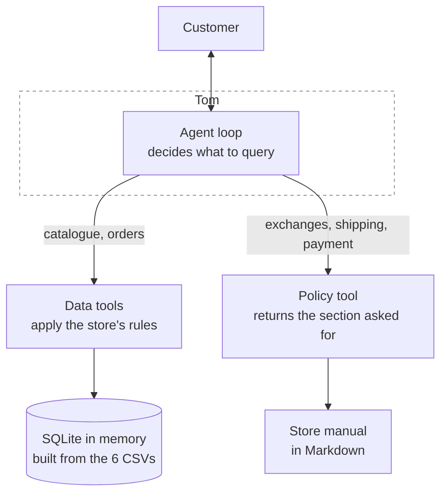

# Tom · Customer service agent for Empório da Música

Text message customer service agent for a musical instrument store. It answers questions
about the catalogue, prices, availability and order status, and applies the store's
policies on exchanges, returns, shipping, payment and warranty.

The Portuguese version of this documentation is in [README-PTBR.md](README-PTBR.md).

Built as a technical case for the AI Engineer role at Artefact, November 2026.

## The problem

Empório da Música is an instrument store in Campo Grande/MS. Customer service is handled
entirely by the team, which is overloaded with recurring questions: opening hours, order
status, price and availability.

Tom absorbs those questions. To do that he needs two different sources: the operational
data, which sits in spreadsheets, and the internal policy manual, which is a text
document in pdf. Deciding which of the two to query, on every message, is the central
problem of this project.

---

## How to run

Python 3.11 or newer, and an OpenAI API key.

```bash
git clone https://github.com/LeandroNani/music-store-support-agent.git
cd music-store-support-agent

python3 -m venv .venv && source .venv/bin/activate
pip install -e ".[dev]"

cp .env.example .env     # open .env and fill in OPENAI_API_KEY
```

Start the interface:

```bash
streamlit run app.py
```

Run the tests, which need no key and no internet:

```bash
pytest
```

The default model is `gpt-6-luna`, the cheapest in the lineup with native tool calling. To
change it, edit `OPENAI_MODEL` in `.env`.

The database is built in memory from the CSVs in `data/raw` every time the application
starts. There is no database to install, and the original files are never changed.

---

## Architecture



The agent never reaches the data directly. It calls functions, and the functions apply
the store's rules before returning the result: the price arrives with any switched-off
promotion already discarded, a product that has run out arrives flagged as out of
stock, and a customer's order only arrives if whoever is asking has confirmed their
contact details.

**The tools available**

| Tool | What for | What comes already resolved |
|---|---|---|
| `search_products` | Search by type, price range, string material or pickup | Final price, PIX price, stock status, 10 per page plus the total |
| `get_product_details` | A specific model, by name or by code | Active promotion, maximum installments, specifications |
| `get_order_status` | The status of an order | Identity checked, return and warranty deadlines already calculated |
| `list_categories` | What the store works with | How many products each category holds today |
| `get_policy_section` | A policy section, by number | Sections for the team's internal use are left out |

---

## Technical decisions

The decisions that structure the project are in
**[docs/DECISIONS.md](docs/DECISIONS.md)**, each one with the alternatives I considered
and what the choice costs. The main ones:

| Decision | Summary |
|---|---|
| Approach | ReAct loop with native function calling, no agent framework |
| Policies | Retrieval by section, no vector database |
| Data | Hand written queries over SQLite in memory, no SQL agent |
| Business rules | Arithmetic and eligibility in Python, inside the tools |
| Security | Identity check as a required function parameter |
| Interface | Streamlit, with a trace panel for development |
| Prompt | A single system prompt, with the manual's index injected, no examples |
| Model and provider | OpenAI API with GPT-6 Luna, for native and mature function calling (D-08) |
| Conversation history | Kept within the session so follow-up questions work, not across sessions (S-05) |
| Data handling | Normalization at load time, and the manual transcribed from pdf to markdown |

---

## Assumptions

The brief asks for ambiguities to be resolved with a reasonable interpretation and
documented. There are eight, in **[docs/ASSUMPTIONS.md](docs/ASSUMPTIONS.md)**. The ones
that change the behavior most:

- **Tom talks to the customer**, not to the team. Section 7 of the manual already had
  the virtual assistant doing customer service, and the way it helps the team is by
  absorbing the repeated questions.
- **WhatsApp is the channel in the story, not a technical requirement.** That sets the
  tone, and it has a price: without the real channel, the customer's phone number is
  not verified.
- **The agent uses the real date.** The orders in the dataset run up to March 2026, so
  the return windows have already closed, and the right answer becomes stating the date
  on which each one closed.
- **Tom only reads.** He does not create, does not cancel, does not change a customer
  record and does not log a complaint, because there is nowhere to write and because an
  agent that talks to the public and writes to the database needs controls beyond the
  scope of a prototype.

---

## Business rules and tests

The store manual is text (pdf) written for people. To become code, each rule had to be
extracted, checked against the real data and decided. At several points the manual
conflicts with the dataset, and those conflicts have no ready answer anywhere in the
material I was given.

**[docs/BUSINESS_RULES.md](docs/BUSINESS_RULES.md)** is that catalogue: each rule with
the policy section it came from, the conflicts and how they were decided, and a matrix
linking the rules that became code to the test that covers them. No test in this
repository exists without a row in that matrix. The reverse does not hold: a good part
of the manual's rules is served to the model as text, with no code of its own, and those
have no row.

---

## Security

The defense sits in how the agent is built, not in a prompt instruction.
Tom never receives a customer's order unless the phone number and e-mail have matched the
record, because the check is a required function parameter. He has no way to
reveal data that never reached him, and he has no tool that creates, changes or deletes
anything.

Usage controls, such as an attempt limit per customer and a spend alert, were
deliberately left out: in a prototype with no persistent identity the counter resets when
the person opens another conversation. That control belongs to the channel layer and to
the API account.

The full reasoning, including a vector that is still open, is in
[docs/DECISIONS.md](docs/DECISIONS.md), decision D-15.

---

## Known limitations

- **The phone number given is not verified.** The identity check compares what the
  customer types with the record. On real WhatsApp, the number would come from the
  connection.
- **The date of receipt does not exist in the dataset.** The deadlines count from the
  estimated delivery, which is the closest field. An order that was late has the wrong
  date, and on the short side.
- **No usage limit.** There is no control on attempts or on volume per customer. It is
  deliberate: in a prototype with no persistent identity, that control resets when the
  person opens another conversation.
- **A product description is free text that the store fills in** and that reaches the model's
  context. The tools return data with labeled fields to reduce the risk, but the vector
  is still open.
- **The history does not survive the session.** Close the tab and the conversation is over.
- **Streamlit is a prototype**, not a production interface.

## Next steps

In order of what I would do first.

**Real WhatsApp integration.** The phone number starts arriving verified by the channel,
and the identity check stops depending on what the customer types. It is the most serious
limitation in the list above.

**Admin panel.** Three things the manager needs to see and nobody sees today: the
data inconsistencies this dataset has (a coming-soon product already sold, an
order with a total that differs from the sum of its items, a discontinued product with
stock), the lookups that failed the check, and the questions Tom could not answer.

**Usage limit at the channel layer**, by phone number, plus a spend alert on the API
account. Both are kept outside the agent on purpose.

**A decision model for the classification, with JEV.** Deciding whether the message is
about the catalogue, an order or a policy today costs a full LLM call. JEV, from
TypeSafe AI, is a model made for that kind of choice between closed options, and it does
it faster and cheaper than a full call. Out of scope now because it is in early access,
which would stop the evaluator from running the project.

**An automated evaluation set.** Today the tests guarantee the rules, not the quality of
the answer. A set of questions with the expected behavior would catch prompt regression,
which is the kind of defect no unit test sees. That is how the three problems documented
in [docs/DECISIONS.md](docs/DECISIONS.md) turned up, running by hand.

**Mutation testing**, to confirm the suite breaks when the code changes. It was done by hand on four rules, and it should be automatic.

---

## Use of an AI assistant

The brief asks for the use of AI tools to be explained. The tool was Claude Code, in
Anthropic's desktop application: it drafted, implemented the tools and the interface,
and wrote the tests from the rule catalogue, while the approach, the scope and every
conflict decision stayed with me.

The full account is in **[docs/AI_WORKFLOW.md](docs/AI_WORKFLOW.md)**: which tool, at
which stages, what was delegated, what was not, and the constraints I put on the
assistant, recorded in **[AGENTS.md](AGENTS.md)**.

---

## Conversation examples

Five conversations run in the interface, against the real dataset and the real manual, in
**[examples/](examples/)**. Each screenshot shows the conversation and the lookups Tom
made to answer.

1. **Promotion, PIX and installments.** Four figures in the answer, none of them
   calculated by the model, and the discount taking the product out of the combined
   payment band.
2. **Delivery to another city.** A policy question, and Tom asking for the postcode
   instead of estimating a shipping cost the material I was given does not state.
3. **Order in transit, with identity check.** The model called the tool with the phone
   number and e-mail blank, and did not receive the order.
4. **A product that is not on sale yet.** Coming soon with stock, an inconsistency in the
   dataset, and Tom not selling what the store does not deliver.
5. **A question outside the store's scope.** No tool called, and the subject back to the
   store.
