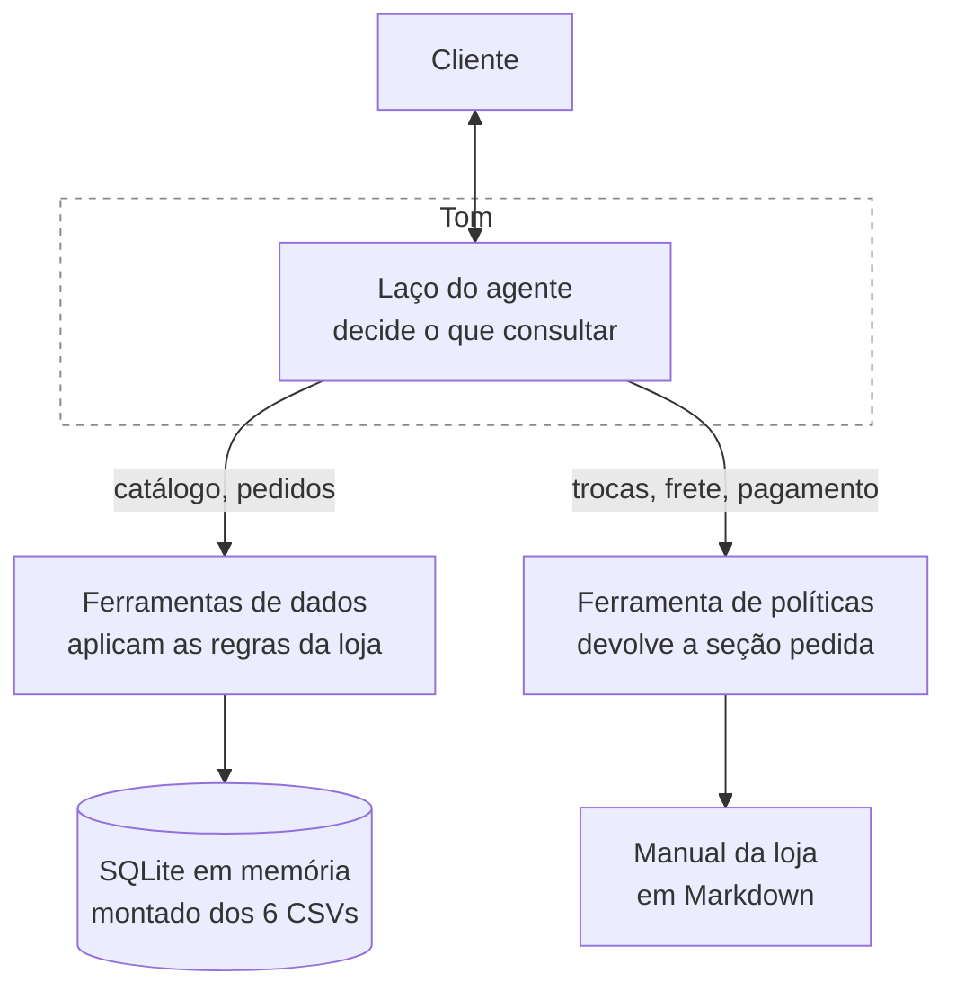

# Tom · Agente de atendimento da Empório da Música

Agente de atendimento por mensagem de texto para uma loja de instrumentos musicais.
Responde dúvidas sobre catálogo, preços, disponibilidade e status de pedido, e aplica
as políticas da loja em trocas, devoluções, frete, pagamento e garantia.

Construído como caso técnico para a vaga de AI Engineer na Artefact, novembro de 2026.

> **Nota de idioma:** a documentação está sendo escrita em português durante o
> desenvolvimento e será traduzida para inglês antes da entrega. Esta nota sai na
> versão final.

---

## O problema

A Empório da Música é uma loja de instrumentos em Campo Grande/MS. O atendimento é
feito inteiramente pela equipe, que está sobrecarregada com perguntas recorrentes:
horário de funcionamento, status de pedido, preço e disponibilidade.

O Tom absorve essas perguntas. Para isso ele precisa de duas fontes diferentes: os
dados da operação, que estão em planilhas, e o manual interno de políticas, que é um
documento de texto em pdf. Decidir qual das duas consultar, a cada mensagem, é o problema
central deste projeto.

---

## Como rodar

> _Seção a preencher quando o projeto estiver executável._
>
> - Pré-requisitos
> - Instalação do ambiente
> - Configuração da chave de API
> - Comando para subir a interface
> - Comando para rodar os testes

---

## Arquitetura

O agente nunca acessa os dados diretamente. Ele chama funções, e as funções já aplicam
as regras da loja antes de devolver o resultado: o preço chega com a promoção vencida já
descartada, o produto esgotado chega marcado como fora de estoque, e o pedido de um
cliente só chega se quem está perguntando tiver confirmado os dados de contato dele.

**As ferramentas disponíveis**

> _Tabela a preencher conforme a implementação._

---

## Decisões técnicas

As decisões que estruturam o projeto estão em
**[docs/DECISIONS.md](docs/DECISIONS.md)**, cada uma com as alternativas que considerei
e o que a escolha custa. As principais:

| Decisão | Resumo |
|---|---|
| Abordagem | Laço ReAct com function calling nativo, sem framework de agente |
| Políticas | Recuperação por seção, sem banco vetorial |
| Dados | Consultas escritas à mão sobre SQLite em memória, sem agente de SQL |
| Regras de negócio | Em Python, dentro das ferramentas, nunca no prompt |
| Segurança | Verificação de identidade como parâmetro obrigatório da função |
| Interface | Streamlit, com painel de trace para desenvolvimento |

---

## Suposições

O enunciado pede que ambiguidades sejam resolvidas com uma interpretação razoável e
documentadas. As decisões estão em **[docs/ASSUMPTIONS.md](docs/ASSUMPTIONS.md)**.

> _Resumo das principais a preencher._

---

## Regras de negócio e testes

O manual da loja é em texto (pdf) escrita para pessoas. Para virar código, cada regra precisou
ser extraída, confrontada com os dados reais e decidida. Em vários pontos o manual
conflita com o conjunto de dados, e esses conflitos não têm resposta pronta em lugar
nenhum do material recebido.

**[docs/BUSINESS_RULES.md](docs/BUSINESS_RULES.md)** é esse catálogo: cada regra, sua
origem, onde ela é aplicada no código e qual teste a cobre. Nenhum teste deste
repositório existe sem uma linha correspondente nesse documento.

---

## Segurança

A defesa principal não é uma instrução no prompt, é a forma como o agente foi montado.
O Tom nunca recebe o pedido de um cliente sem que telefone e e-mail tenham batido com o
cadastro, porque a verificação é parâmetro obrigatório da função. Ele não tem como
revelar um dado que nunca chegou até ele, e não tem nenhuma ferramenta que crie, altere
ou apague qualquer coisa.

Controles de uso, como limite de tentativas por cliente e alerta de gasto, foram
deliberadamente deixados de fora: num protótipo sem identidade persistente eles têm
aparência de controle sem serem um. O lugar deles é a camada do canal e a conta da API.

O raciocínio completo, incluindo um vetor que continua aberto, está em
[docs/DECISIONS.md](docs/DECISIONS.md), decisão D-15.

---

## Limitações conhecidas

> _Seção a preencher ao final._

## Próximos passos

> _Seção a preencher ao final. Inclui, no mínimo:_
> - _Modelo de decisão dedicado para classificar a mensagem recebida, em vez de gastar_
>   _uma chamada de LLM nisso_
> - _Painel administrativo com histórico entre sessões e métricas de atendimento_
> - _Painel de inconsistências de cadastro para o gerente: produto marcado como_
>   _lançamento futuro que já foi vendido, pedido com total divergente da soma dos_
>   _itens, produto descontinuado com estoque em aberto_
> - _Integração real com o WhatsApp, onde o telefone do cliente vem verificado pelo_
>   _próprio canal e a checagem de identidade deixa de depender do que ele digita_
> - _Limite de tentativas de verificação por número de telefone, na camada do canal,_
>   _com as tentativas que falharam visíveis no painel do administrador_
> - _Alerta de gasto na conta da API_
> - _Teste de mutação, para provar que a suíte de testes detecta alteração no código_
> - _Conjunto de avaliação automatizado para as respostas do agente_

---

## Uso de assistente de IA

O enunciado pede que o uso de ferramentas de IA seja explicado. O relato está em
**[docs/AI_WORKFLOW.md](docs/AI_WORKFLOW.md)**: qual ferramenta, em que etapas, o que
foi delegado, o que não foi, e as restrições que impus ao assistente, registradas em
**[AGENTS.md](AGENTS.md)**.

---

## Exemplos de conversa

Em **[examples/](examples/)**.

> _Lista a preencher._
