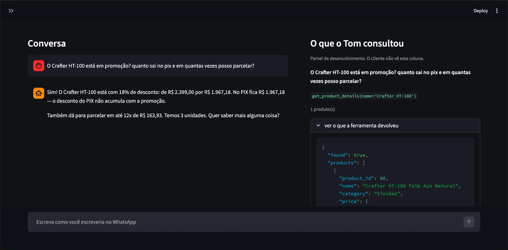
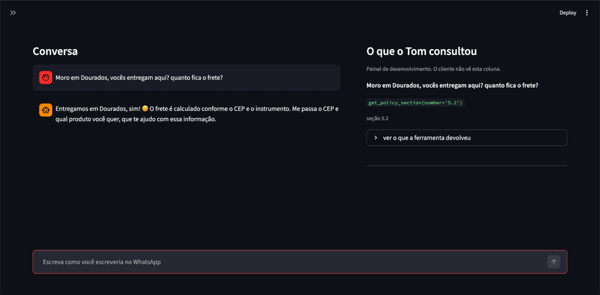
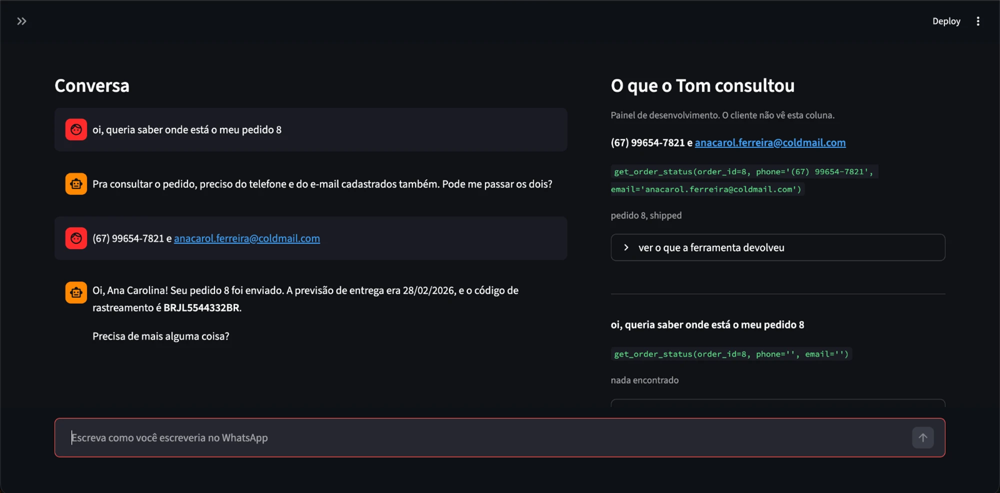
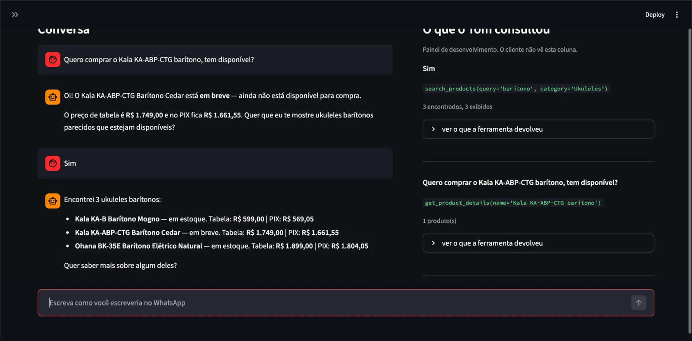
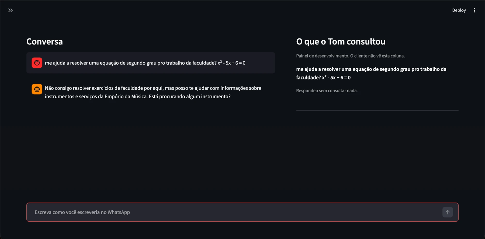

# Exemplos de conversa

Cinco conversas rodadas na interface, contra a base e o manual de verdade. Cada print
mostra as duas colunas: a conversa à esquerda, as consultas que o Tom fez à direita. No
painel da direita, a consulta mais recente aparece em cima.

A data de referência do Tom é a data real da máquina. Os prints foram tirados em
**02/11/2026**.

---

## 1. Promoção, PIX e parcelamento

**Cliente:** O Crafter HT-100 está em promoção? quanto sai no pix e em quantas vezes posso parcelar?

Quatro números na resposta e nenhum deles calculado pelo modelo: R$ 2.399,00 de tabela,
R$ 1.967,18 com os 18% da promoção, o mesmo valor no PIX e 12x de R$ 163,93.

O PIX não baixa mais o preço porque o manual diz que desconto não acumula, e quem
decide isso é a função. O desconto também tira o produto da faixa de pagamento
combinado: a tabela passa de R$ 2.000,00, o preço final não.

## 2. Entrega para outra cidade

**Cliente:** Moro em Dourados, vocês entregam aqui? quanto fica o frete?

Pergunta de política, não de dados: uma consulta à seção 5.2 do manual. O valor do frete
depende do CEP e do instrumento, e isso não está em lugar nenhum do material recebido,
então o Tom pede o CEP em vez de estimar um número.

## 3. Pedido em trânsito, com verificação de identidade

**Cliente:** oi, queria saber onde está o meu pedido 8
**Cliente:** (67) 99654-7821 e anacarol.ferreira@coldmail.com

A conversa mais importante do conjunto, por causa da consulta de baixo no painel:
**o modelo chamou `get_order_status` com telefone e e-mail em branco.** Telefone e e-mail
são parâmetros obrigatórios da ferramenta, e a descrição dela manda pedir os dados ao
cliente antes de chamar. Ele chamou mesmo assim, preenchendo os dois com string vazia.

A função procurou o pedido 8 com aqueles dados, não encontrou nenhum que batesse e
devolveu nada encontrado. Só então o Tom pediu telefone e e-mail. Se a verificação fosse
uma instrução no prompt em vez de um parâmetro, o pedido da Ana Carolina teria saído
para quem digitou o número 8. Decisão D-06 em [docs/DECISIONS.md](../docs/DECISIONS.md).

Com os dados certos, vem código de rastreamento e previsão de entrega. A previsão é
anterior a hoje, e a resposta diz isso: era 28/02/2026.

## 4. Produto que ainda não está à venda

**Cliente:** Quero comprar o Kala KA-ABP-CTG barítono, tem disponível?
**Cliente:** Sim

Esse produto é uma armadilha da base: está marcado como lançamento futuro e tem duas
unidades em estoque. O Tom informa que ainda não está disponível em vez de vender o que
a loja não pode entregar, e oferece alternativa.

Na lista que vem em seguida ele aparece de novo, entre os outros dois barítonos e
marcado como em breve. Produto indisponível não some da busca: some a chance de o
cliente perguntar de novo pelo mesmo modelo.

## 5. Pergunta fora do escopo da loja

**Cliente:** me ajuda a resolver uma equação de segundo grau pro trabalho da faculdade? x² - 5x + 6 = 0

Nenhuma ferramenta é chamada, como o painel registra. O Tom diz o que atende e volta
para o assunto da loja. Um agente de atendimento que responde qualquer coisa é uma conta
de API aberta para o público usar como quiser.
