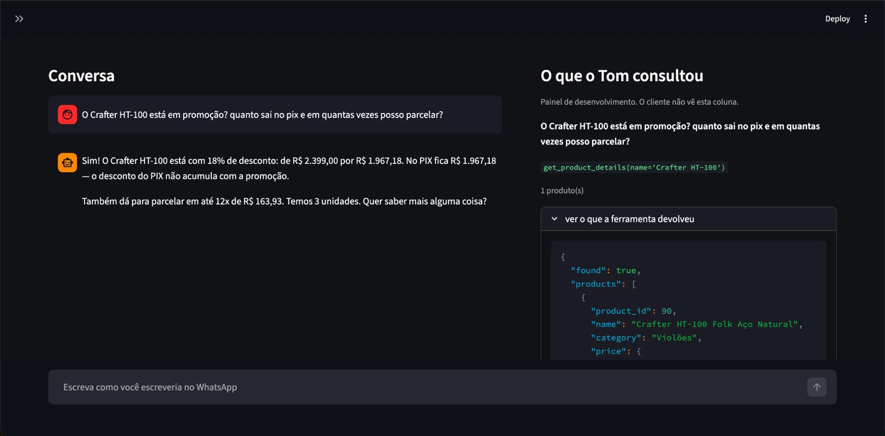
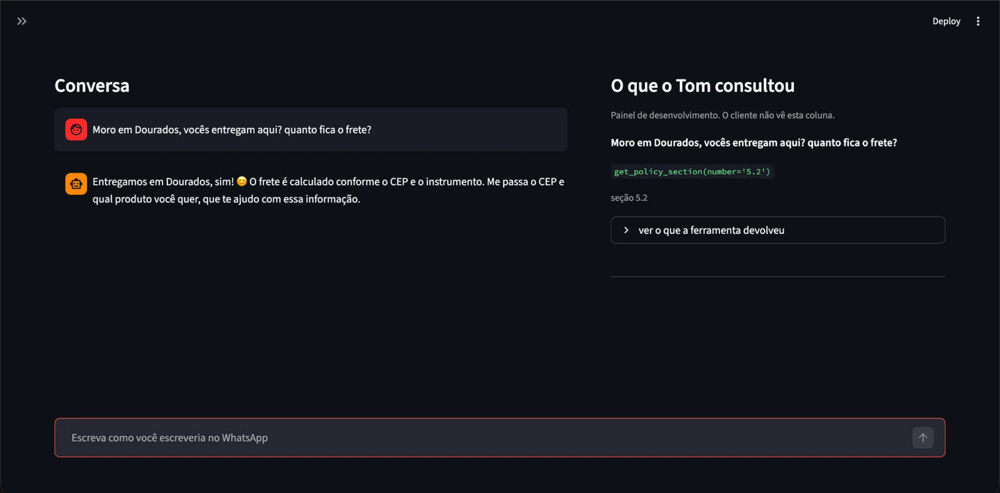
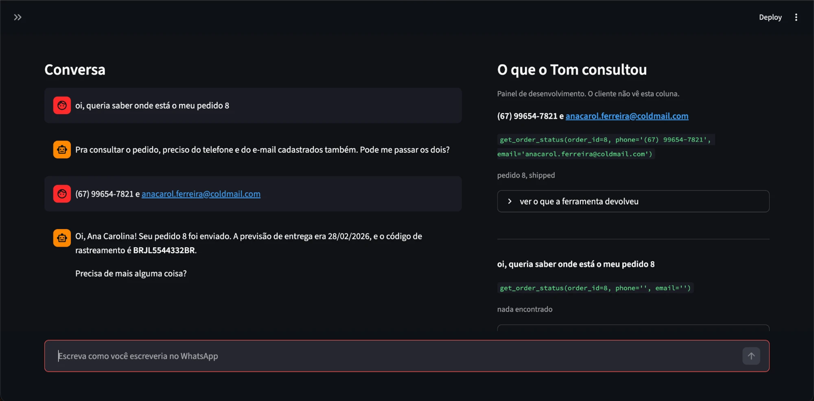
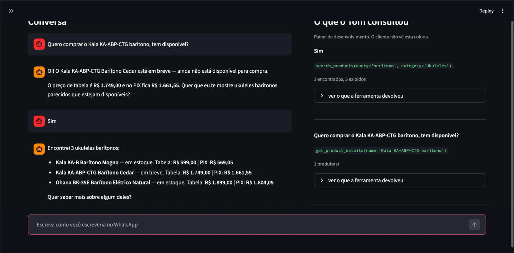
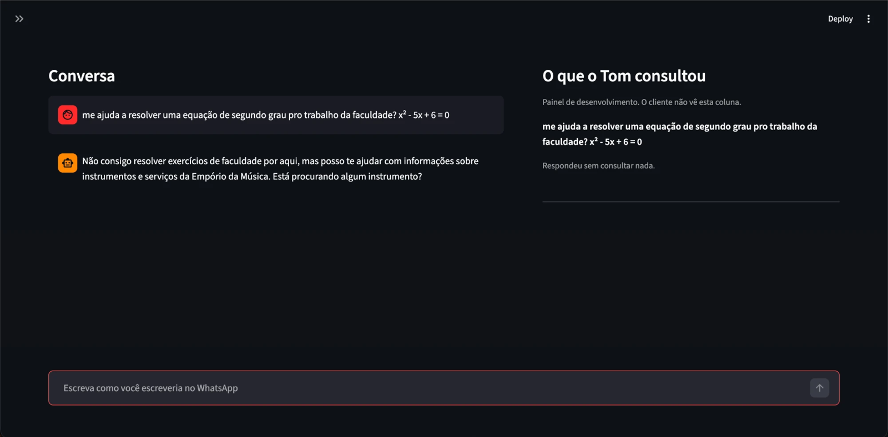

# Conversation examples

Five conversations run in the interface, against the real dataset and the real manual.
Each screenshot shows the two columns: the conversation on the left, the lookups Tom made
on the right. In the right hand panel, the most recent lookup appears on top.

Tom's reference date is the machine's real date. The screenshots were taken on
**2026-11-02**.

---

## 1. Promotion, PIX and installments

**Customer:** O Crafter HT-100 está em promoção? quanto sai no pix e em quantas vezes posso parcelar?

Four figures in the answer and none of them calculated by the model: R$ 2.399,00 list
price, R$ 1.967,18 with the promotion's 18%, the same amount on PIX and 12x of R$ 163,93.

PIX does not lower the price any further because the manual says a discount does not
stack, and the function is what decides that. The discount also takes the product out of
the combined payment band: the list price is above R$ 2.000,00, the final price is not.

## 2. Delivery to another city

**Customer:** Moro em Dourados, vocês entregam aqui? quanto fica o frete?

A policy question, not a data one: one lookup of section 5.2 of the manual. The shipping
cost depends on the postcode and on the instrument, and that is nowhere in the material I
was given, so Tom asks for the postcode instead of estimating a number.

## 3. Order in transit, with identity check

**Customer:** oi, queria saber onde está o meu pedido 8
**Customer:** (67) 99654-7821 e anacarol.ferreira@coldmail.com

The most important conversation in the set, because of the bottom lookup in the panel:
**the model called `get_order_status` with the phone number and e-mail blank.** Phone
number and e-mail are required parameters of the tool, and its description says to ask the
customer for the data before calling. It called anyway, filling both with an empty string.

The function looked for order 8 with that data, found none that matched and returned
nothing found. Only then did Tom ask for the phone number and e-mail. If the check were an
instruction in the prompt instead of a parameter, Ana Carolina's order would have gone out
to whoever typed the number 8. Decision D-06 in [docs/DECISIONS.md](../docs/DECISIONS.md).

With the right data, the tracking code and the estimated delivery come back. The estimate
is earlier than today, and the answer says so: it was 2026-02-28.

## 4. A product that is not on sale yet

**Customer:** Quero comprar o Kala KA-ABP-CTG barítono, tem disponível?
**Customer:** Sim

This product is a trap in the dataset: it is flagged as coming soon and has two units in
stock. Tom says it is not available yet instead of selling what the store cannot deliver,
and offers an alternative.

In the list that comes next it shows up again, among the other two baritones and flagged
as coming soon. A product that is not available stays in the search, flagged. Hiding it
would make the customer think the store does not work with that.

## 5. A question outside the store's scope

**Customer:** me ajuda a resolver uma equação de segundo grau pro trabalho da faculdade? x² - 5x + 6 = 0

No tool is called, as the panel records. Tom says what he handles and goes back to the
store's subject. Answering anything at all would turn the store's API account into a free
service for whoever wants to use it.
